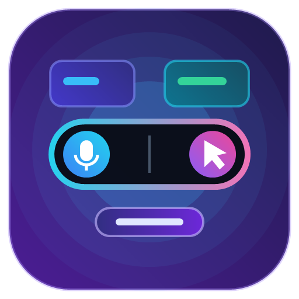
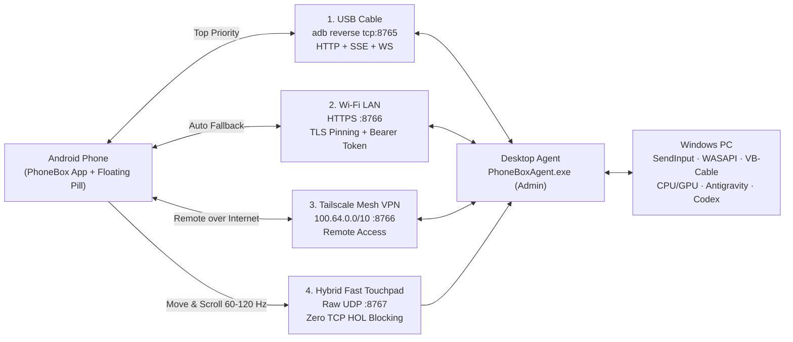

<h1 align="center">PhoneBox (AI Coding &amp; Dev Edition) — Architecture, Features &amp; Connections</h1>

  <b>English</b> ·
  <a href="FEATURES-AND-CONNECTIONS.vi.md">Tiếng Việt</a>

> **Credits &amp; Upstream Attribution:** This repository is an extended fork built upon the open-source **[ersinkoc/phonebox](https://github.com/ersinkoc/phonebox)** project (**MIT License**). This extended edition adds low-latency hybrid UDP/WebSocket Touchpad with Windows Admin auto-elevation (UIPI bypass), system-wide Android Floating Overlay Pill (Mic + Touchpad), 2-way audio streaming (`PhoneMic` &amp; `PhoneSpeaker`), live Antigravity &amp; Codex bridges, 48-band FFT Dynamic Edge Lighting / Liquid Wave, and USB/ADB priority safeguards.

---

## 1. Comparison: Upstream (`ersinkoc/phonebox`) vs. Extended Fork

| Area | Upstream (`ersinkoc/phonebox`) | Extended Fork (This Repo) |
|---|---|---|
| **Widget Dashboard** | 12 × 6 grid, Smart Stack, visual layout editor | Expanded to **127 widget types** (9 categories) &amp; **33 templates** (including `touchpad`, `phonemic`, `codex`, `*-deck`) |
| **Remote Touchpad &amp; Keyboard** | Basic HTTP / key shortcuts | **Ultra-low-latency Hybrid Touchpad** (`MouseLink.kt` + `KeySender.cs`): 60–120 Hz WebSocket + **MouseDroid-style Raw UDP `:8767`** |
| **Admin Window Control (UIPI)** | Standard user integrity | **Automatic Administrator Auto-Elevate** (`Program.cs` `runas` + `--no-elevate`), controlling elevated windows (**Admin PowerShell, Task Manager**) |
| **System-Wide Floating Pill** | Inside PhoneBox app only | **Floating Overlay Pill** (`PhoneMicService.kt`): persistent Mic + Touchpad toggle pill floating over Android Home and any other app |
| **2-Way PC ↔ Phone Audio** | Spectrum visualizer only | **PhoneMic** (48 kHz mono → `VB-Audio Virtual Cable`, hardware AEC/NS/AGC) + **PhoneSpeaker** (24 kHz WASAPI Loopback → phone speaker with auto Silent Sink) |
| **AI Coding Integration** | Quotas &amp; Claude Code permission hook | Adds **AntigravityChatWatcher** + **AntigravityVoiceTrigger** (native C# Win32 `~10 ms`) + **CodexChatWatcher** (`codex://`), live chat stream &amp; project/session switching |
| **Dynamic Media Visuals** | Standard media &amp; spectrum bars | **Apple Music / ColorOS Dynamic Mesh Gradient**, **Realme Edge Lighting** &amp; **Liquid Wave** driven by **48-band FFT @ 30 FPS** |
| **USB/ADB Coexistence** | Basic `adb reverse tcp:8765` | Enforces `ADB_LIBUSB=0` and auto-restores PhoneBox foreground if another ADB bridge (e.g. `TinyPrintBridge :9100`) steals focus |

---

## 2. Architecture &amp; Connection Modes

PhoneBox pairs an **Android App (`net.oxog.phonebox.deskpanel`)** with a lightweight **Desktop Agent (`PhoneBoxAgent` — .NET 10)** — zero cloud account or middleman servers required.

### Details of the 5 Data Channels

| Channel | Port / Protocol | Security | Purpose |
|---|---|---|---|
| **1. USB (`adb reverse`)** | `http://127.0.0.1:8765` (HTTP/1.1 + WS + SSE) | Local USB tunnel only | Priority #1: initial pairing, APK updates via ADB, auto-wake &amp; panel launch, lowest jitter |
| **2. Wi-Fi LAN** | `https://<LAN-IP>:8766` (HTTPS + WS + SSE) | **Self-Signed ECDSA P-256 TLS** + **SHA-256 Certificate Pinning** + Bearer Token | Wireless desk use on the same Wi-Fi; automatic seamless fallback when USB is unplugged |
| **3. Tailscale Mesh VPN** | `https://<100.x.y.z>:8766` | Tailscale WireGuard encryption + TLS Pinning + Bearer Token | Remote PC monitoring, AI sessions, and touchpad control outside your LAN |
| **4. Hybrid Touchpad (WS + Raw UDP)** | WS `/api/mouse/ws` (`:8765` / `:8766`) + **Raw UDP `:8767`** | UDP authenticated by **16-byte Token Prefix** (`FixedTimeEquals`) | Relative mouse moves &amp; scrolling over UDP (zero TCP head-of-line blocking); clicks/drag/keys/text over `TCP_NODELAY` WebSocket |
| **5. Real-Time Streams** | SSE `/api/stream`, WS `/api/mic/ws`, WS `/api/speaker/ws` | Existing USB / TLS-pinned session | 1s PC state updates, 30 FPS FFT spectrum, 48 kHz phone mic to PC, 24 kHz PC audio to phone |

> **Smart Route Switching (`AgentLink.kt`):** Connect via USB once (or scan the Wi-Fi pairing QR code) to store the PC's LAN/Tailscale addresses, token, and pinned certificate fingerprint (`lan-cert.pfx`). When plugged in, **USB always takes top priority**; when unplugged, PhoneBox switches seamlessly to **Wi-Fi / Tailscale**.

---

## 3. Feature Breakdown

### 3.1. Low-Latency Touchpad &amp; Keyboard (`MouseLink.kt` + `KeySender.cs`)
- Streams relative cursor movement (`m,dx,dy`), vertical/horizontal scroll (`s,dy,dx`), clicks/double-clicks/drag (`c`, `2`, `d`, `u`), Unicode text (`t`), and key combos (`k`) at 60–120 Hz.
- **Windows UIPI Bypass:** `PhoneBoxAgent.exe` automatically elevates to Administrator (`Verb = "runas"`, `--no-elevate`) so `SendInput` and `SetCursorPos` operate smoothly inside **Administrator PowerShell**, **Task Manager**, and UAC-elevated apps.
- **Floating Overlay Pill:** Stays accessible above Android Home and other apps for one-tap Mic mute/unmute and floating Touchpad toggling.

### 3.2. 2-Way Audio System (`PhoneMic.cs`, `PhoneSpeaker.cs` &amp; `PhoneMicService.kt`)
- **Phone as PC Microphone (`/api/mic/ws`):** Captures **48 kHz 16-bit mono PCM** on Android with hardware `NoiseSuppressor`, `AcousticEchoCanceler`, and `AutomaticGainControl`, streaming into **VB-Audio Virtual Cable (`CABLE Input`)** for Discord, Zoom, OBS, or voice dictation.
- **PC Audio to Phone (`/api/speaker/ws`):** Captures Windows playback via **WASAPI Loopback**, resamples to **24 kHz 16-bit mono** (20 ms chunks), and optionally switches Windows default playback to a silent sink (`pcSilenced`) while streaming, automatically restoring physical speakers when stopped.

### 3.3. Live AI Coding Bridges
- **Antigravity Bridge (`AntigravityChatWatcher.cs` + `AntigravityVoiceTrigger.exe`):** Live transcript &amp; voice-chat stream, project/conversation switching, and instant **Voice Mode (`Ctrl+M`)** trigger via native C# Win32 (`~10 ms`).
- **Codex Bridge (`CodexChatWatcher.cs`):** Lists local Codex rollout sessions by project and opens threads directly in desktop (`codex://`).
- **Claude Code Hook (`ClaudeHook.cs`):** Remote **Allow / Deny** permission prompts directly from the phone.
- **Quotas &amp; GitHub (`QuotaMonitor.cs`, `GitHubMonitor.cs`):** Tracks Claude, Codex, Antigravity usage quotas, burn rates, and GitHub PR/CI status.

### 3.4. Dynamic Media, 48-Band FFT Spectrum &amp; Edge Lighting
- **FFT Spectrum Analyzer (`SpectrumAnalyzer.cs`):** Runs WASAPI loopback capture with Hann window + **2048-point FFT** across **48 log-spaced frequency bands (40 Hz – 16 kHz)** pushed at **30 FPS**.
- **Visual Engine (`W.media` / `style.css`):** Combines dynamic album-art Mesh Gradient backgrounds with **Realme Edge Lighting** and **Liquid Wave** beat-reactive shaders.

### 3.5. Control Deck, Hardware Telemetry &amp; Automation
- **Control Deck (`ControlDeck.cs`):** Per-app WASAPI audio mixer, Spotify control, **OBS Studio** scenes/streaming, **Discord** voice controls, multi-step macros, and quick task runners.
- **System &amp; Process Monitor (`SystemMonitor.cs`, `ProcessMonitor.cs`, `BatteryMonitor.cs`):** CPU, GPU (`nvidia-smi` / Windows counters / LibreHardwareMonitor), RAM, disk, network, ping, peripheral wireless batteries, and live process viewer with optional kill support.
- **127 Widgets &amp; 33 Templates:** Covers Time (11), Personal (10), Weather &amp; Sky (5), Computer (25), Web &amp; Data (10), AI &amp; Code (5), AI (2), Control Deck (58), Layout (1), plus **Home Assistant**, Webhooks (`/api/push`, `/api/notify`, `/api/goto`, `/api/refresh`), **RuleEngine**, and **ChargeGuard** battery protection.

---

## 4. Brand Identity (`Floating Pill Pro` — Icon #10)

Both the Windows desktop agent ([`phonebox.ico`](../agent/PhoneBox.Agent/phonebox.ico)) and Android launcher ([`ic_launcher_fg.xml`](../android/app/src/main/res/drawable/ic_launcher_fg.xml)) share the custom **Floating Pill Pro** emblem (`docs/icon.png`), representing the signature dual Mic + Touchpad floating dock surrounded by widget tiles.

---

## License

Licensed under the **MIT License** — see [LICENSE](../LICENSE). Built on top of [ersinkoc/phonebox](https://github.com/ersinkoc/phonebox).
