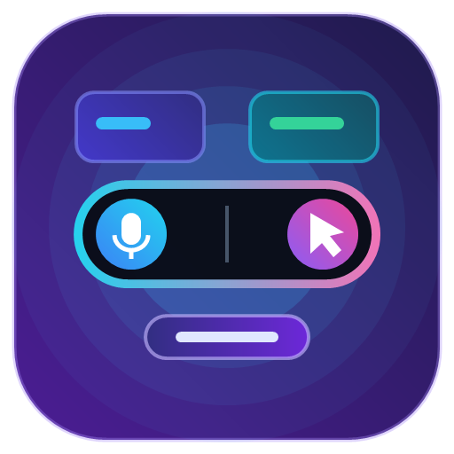
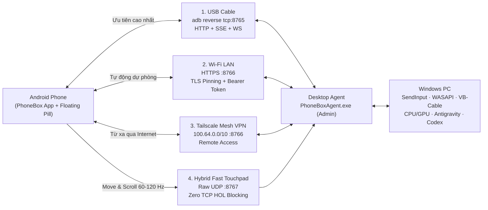

<h1 align="center">PhoneBox (Bản dành cho Dân Coding &amp; AI Dev) — Kiến Trúc, Chức Năng &amp; Kết Nối</h1>

  <a href="FEATURES-AND-CONNECTIONS.md">English</a> ·
  <b>Tiếng Việt</b>

> **Nguồn gốc &amp; Ghi công (Credits):** Dự án này được phát triển tiếp (clone/fork nâng cấp) trên nền mã nguồn mở **[ersinkoc/phonebox](https://github.com/ersinkoc/phonebox)** (giấy phép **MIT**). Phiên bản mở rộng này bổ sung các phân hệ điều khiển chuyên sâu trên Windows &amp; Android như Touchpad lai UDP/WebSocket vượt quyền UIPI Admin, Floating Overlay Pill (Mic + Chuột nổi toàn hệ thống), Đàm thoại âm thanh 2 chiều, Cầu nối AI Coding trực tiếp (Antigravity &amp; Codex), Dynamic Edge Lighting / Liquid Wave theo nhịp nhạc FFT, và cơ chế ưu tiên USB ADB song song.

---

## 1. So sánh: Bản Gốc (`ersinkoc/phonebox`) vs. Bản Fork Nâng Cấp

| Hạng mục | Bản gốc (`ersinkoc/phonebox`) | Bản Fork Nâng Cấp (Repo này) |
|---|---|---|
| **Bảng điều khiển Widget** | Lưới 12 × 6, Smart Stack, chỉnh sửa trực quan | Mở rộng lên **127 loại widget** (9 nhóm) & **33 mẫu trang** (gồm `touchpad`, `phonemic`, `codex`, bộ `*-deck`) |
| **Touchpad & Bàn phím PC** | HTTP/Shortcut phím cơ bản | **Hybrid Touchpad độ trễ thấp** (`MouseLink.kt` + `KeySender.cs`): WebSocket 60–120 Hz + **Raw UDP `:8767`** kiểu MouseDroid |
| **Quyền điều khiển Admin (UIPI)** | Chạy quyền User thường | **Tự động nâng quyền Administrator** (`Program.cs` `runas` + `--no-elevate`), rê/click xuyên cửa sổ **Administrator PowerShell / Task Manager** |
| **Thanh nổi ngoài ứng dụng** | Chỉ dùng trong app PhoneBox | **Floating Overlay Pill** (`PhoneMicService.kt`): viên thuốc nổi Mic + Mouse hoạt động đè lên mọi app & màn hình chính Android |
| **Âm thanh 2 chiều PC ↔ Phone** | Chỉ phân tích phổ Spectrum | **PhoneMic** (48 kHz mono → `VB-Audio Virtual Cable`, khử ồn/vang phần cứng) + **PhoneSpeaker** (24 kHz WASAPI Loopback → loa ĐT, tự tắt loa ngoài PC qua Silent Sink) |
| **Tích hợp AI Coding** | Quota & Claude Code Permission Hook | Bổ sung **AntigravityChatWatcher** + **AntigravityVoiceTrigger** (C# Win32 `~10 ms`) + **CodexChatWatcher** (`codex://`), xem chat trực tiếp & chọn phiên theo project |
| **Hiệu ứng Dynamic Media** | Widget media & spectrum cơ bản | **Apple Music / ColorOS Dynamic Mesh Gradient**, **Realme Edge Lighting** & **Liquid Wave** đồng bộ theo phổ nhạc **48 dải FFT @ 30 FPS** |
| **Ổn định USB & Đa cầu nối ADB** | `adb reverse tcp:8765` cơ bản | Ép `ADB_LIBUSB=0`, tự bảo vệ & khôi phục foreground PhoneBox khi chạy song song với các bridge ADB khác (ví dụ `TinyPrintBridge :9100`) |

---

## 2. Sơ Đồ Kiến Trúc & Các Kiểu Kết Nối

PhoneBox kết hợp **Android App (`net.oxog.phonebox.deskpanel`)** và **Desktop Agent (`PhoneBoxAgent` — .NET 10)** không cần dịch vụ đám mây trung gian.

### Chi tiết 5 kênh truyền dữ liệu

| Kênh kết nối | Cổng / Giao thức | Bảo mật | Mục đích sử dụng |
|---|---|---|---|
| **1. USB (`adb reverse`)** | `http://127.0.0.1:8765` (HTTP/1.1 + WS + SSE) | Đường hầm USB cục bộ, không mở ra mạng | Kênh ưu tiên số 1: ghép nối lần đầu, cập nhật APK qua ADB, tự đánh thức & mở panel, độ trễ ổn định nhất |
| **2. Wi-Fi LAN** | `https://<LAN-IP>:8766` (HTTPS + WS + SSE) | **TLS Self-Signed ECDSA P-256** + **SHA-256 Certificate Pinning** + Bearer Token | Hoạt động không dây trong cùng mạng Wi-Fi; tự động fallback khi rút cáp USB |
| **3. Tailscale Mesh VPN** | `https://<100.x.y.z>:8766` | Mã hóa WireGuard của Tailscale + TLS Pinning + Bearer Token | Điều khiển PC, xem tiến trình, AI sessions & Touchpad từ xa ngoài mạng LAN |
| **4. Touchpad Hybrid (WS + Raw UDP)** | WS `/api/mouse/ws` (`:8765` / `:8766`) + **Raw UDP `:8767`** | UDP xác thực bằng **16-byte Token Prefix** (so sánh `FixedTimeEquals`) | Di chuyển chuột & cuộn trang qua UDP không bị nghẽn gói TCP; click/drag/phím/gõ chữ đi qua WebSocket `TCP_NODELAY` |
| **5. Real-Time Streams** | SSE `/api/stream`, WS `/api/mic/ws`, WS `/api/speaker/ws` | Cùng phiên xác thực USB / TLS Pinning | Đẩy trạng thái PC mỗi 1s, phổ nhạc FFT 30 FPS, micro 48 kHz lên PC và loa PC 24 kHz về ĐT |

> **Cơ chế tự chuyển tuyến thông minh (`AgentLink.kt`):** Chỉ cần cắm USB một lần để ghép nối (hoặc quét mã QR Wi-Fi Pair), điện thoại lưu danh sách địa chỉ LAN + Tailscale IP + dấu vân tay chứng chỉ TLS (`lan-cert.pfx`). Khi cắm cáp, **USB luôn được ưu tiên tuyệt đối**; khi rút cáp, app tự chuyển sang **Wi-Fi / Tailscale** liền mạch.

---

## 3. Chi Tiết Các Phân Hệ Chức Năng

### 3.1. Điều Khiển Chuột & Bàn Phím Từ Xa (Touchpad Pro + Floating Pill)
- **Độ trễ cực thấp (`MouseLink.kt` + `KeySender.cs`):** Gửi tọa độ tương đối `dx, dy` (`m,dx,dy`), cuộn dọc/ngang (`s,dy,dx`), click trái/phải/giữa, giữ kéo thả (`d`/`u`), gõ văn bản Unicode và tổ hợp phím tắt.
- **Vượt rào cản UIPI Windows:** `PhoneBoxAgent.exe` tự động nâng quyền Administrator khi khởi chạy (`Verb = "runas"`), giúp `SendInput` và `SetCursorPos` điều khiển được cả **Administrator PowerShell**, **Task Manager**, **Registry Editor** hay các trình cài đặt UAC.
- **Floating Overlay Pill:** Khi thoát app PhoneBox, nút nổi nhỏ gọn (Mic + Touchpad) vẫn bám trên mép màn hình Android để bật nhanh touchpad nổi hoặc micro bất cứ lúc nào.

### 3.2. Hệ Thống Âm Thanh 2 Chiều (Phone Mic & Phone Speaker)
- **Phone as PC Microphone (`/api/mic/ws` — `PhoneMic.cs` & `PhoneMicService.kt`):**
  - Thu âm thanh từ điện thoại ở chuẩn **48 kHz, 16-bit mono PCM**, bật sẵn bộ lọc phần cứng Android (`NoiseSuppressor`, `AcousticEchoCanceler`, `AutomaticGainControl`).
  - Đẩy trực tiếp vào **VB-Audio Virtual Cable (`CABLE Input`)** trên Windows để dùng làm micro cho Discord, Zoom, OBS, họp online hoặc nhập liệu giọng nói.
  - Có nút chỉnh Gain tăng giảm độ nhạy và thanh đo mức âm lượng trực tiếp.
- **PC Audio to Phone (`/api/speaker/ws` — `PhoneSpeaker.cs`):**
  - Bắt âm thanh đang phát trên Windows bằng **WASAPI Loopback**, resample về **24 kHz 16-bit mono** truyền về loa/tai nghe điện thoại (chunk 20 ms).
  - **Chế độ Silent Sink tự động (`pcSilenced`):** Khi điện thoại bật nghe loa PC, agent tự chuyển thiết bị phát mặc định sang cổng ảo/Digital Output để loa ngoài PC im lặng; khi tắt nghe trên điện thoại, tự khôi phục đúng loa gốc ban đầu.

### 3.3. Giám Sát & Điều Khiển AI Coding Assistants
- **Antigravity Bridge (`AntigravityChatWatcher.cs` + `AntigravityVoiceTrigger.exe`):**
  - Theo dõi trực tiếp transcript hội thoại & voice chat của Antigravity, hiển thị live trên điện thoại.
  - Hỗ trợ chuyển đổi giữa các hội thoại / project ngay trên màn hình điện thoại và kích hoạt nhanh chế độ **Antigravity Voice (`Ctrl+M`)** thông qua native Win32 (`~10 ms`).
- **Codex Bridge (`CodexChatWatcher.cs`):**
  - Đọc và chiếu các phiên làm việc Codex cục bộ lên panel điện thoại, hỗ trợ mở thẳng thread trên desktop (`codex://`).
- **Claude Code Permission Hook (`ClaudeHook.cs`):**
  - Khi Claude Code hỏi quyền chạy lệnh/công cụ, đẩy thông báo sang PhoneBox để bấm **Allow** hoặc **Deny** từ xa ngay trên điện thoại.
- **Theo dõi hạn mức & GitHub (`QuotaMonitor.cs`, `GitHubMonitor.cs`):**
  - Hiển thị quota của Claude, Codex, Antigravity, tốc độ tiêu thụ và trạng thái PR/Review/CI trên GitHub.

### 3.4. Dynamic Media, Spectrum FFT & Realme Edge Lighting
- **FFT Spectrum Analyzer (`SpectrumAnalyzer.cs`):** Phân tích tín hiệu âm thanh hệ thống theo thời gian thực qua WASAPI Loopback với cửa sổ Hann, **2048-point FFT**, chia thành **48 dải tần logarit (40 Hz – 16 kHz)** phát qua SSE ở tốc độ **30 FPS**.
- **Hiển thị trực quan (`W.media` / `style.css`):** Kết hợp nền Mesh Gradient chuyển động theo ảnh bìa album (Apple Music / ColorOS style), dải đèn viền chuyển sắc (Edge Lighting) và hiệu ứng sóng nước phản hồi theo nhịp bass/beat.

### 3.5. Control Deck & Giám Sát Hệ Thống Chuyên Sâu
- **Control Deck (`ControlDeck.cs`):** Mixer âm lượng theo từng ứng dụng (WASAPI per-app volume), điều khiển Spotify, điều khiển cảnh/nguồn **OBS Studio**, trạng thái voice **Discord** (mute/deafen/chuyển kênh), phím tắt macro đa bước, chạy tác vụ lệnh nhanh.
- **Giám sát phần cứng & Tiến trình (`SystemMonitor.cs`, `ProcessMonitor.cs`, `BatteryMonitor.cs`):**
  - Theo dõi CPU, RAM, ổ đĩa, mạng, ping, GPU (Windows counters / `nvidia-smi` / LibreHardwareMonitor), pin thiết bị ngoại vi (tai nghe, chuột không dây).
  - Xem danh sách tiến trình kèm icon thật, chi tiết RAM/CPU và cho phép tắt tiến trình từ xa (khi bật `AllowKill`).
- **Tự động hóa & Tiện ích hằng ngày:**
  - **127 Widget** thuộc 9 nhóm (`Control Deck`: 58, `Computer`: 25, `Time`: 11, `Personal`: 10, `Web & data`: 10, `Weather & sky`: 5, `AI & code`: 5, `AI`: 2, `Layout`: 1) và **33 Template** dựng sẵn.
  - Quy tắc tự động (`RuleEngine.cs`), điều khiển **Home Assistant**, Webhook (`/api/push`, `/api/notify`, `/api/goto`, `/api/refresh`), **ChargeGuard** bảo vệ pin điện thoại khi cắm dock 24/7, và trình duyệt camera IP / ảnh khung hình.

---

## 4. Bộ Nhận Diện Mới (`Floating Pill Pro` — Icon #10)

Cả desktop agent ([`phonebox.ico`](../agent/PhoneBox.Agent/phonebox.ico)) và ứng dụng Android ([`ic_launcher_fg.xml`](../android/app/src/main/res/drawable/ic_launcher_fg.xml)) đều dùng chung biểu tượng **Floating Pill Pro** (`docs/icon.png`), mô phỏng thanh viên thuốc nổi đôi **Mic + Touchpad** cùng các thẻ widget đặc trưng của bản fork nâng cấp.

---

## Giấy Phép (License)

Phát hành theo giấy phép **MIT** — xem [LICENSE](../LICENSE). Xây dựng trên nền tảng [ersinkoc/phonebox](https://github.com/ersinkoc/phonebox).
